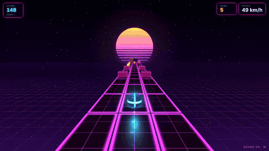
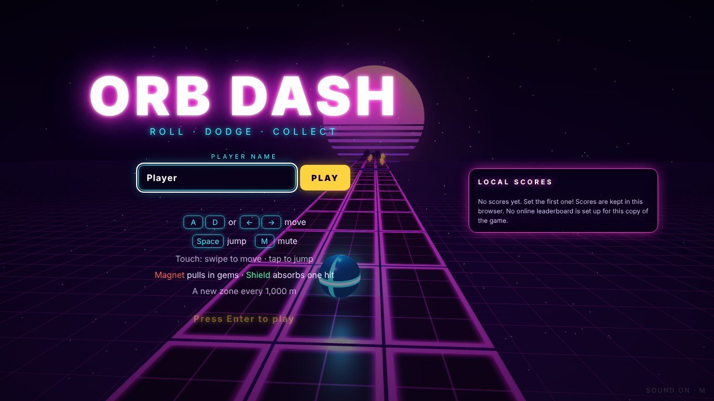
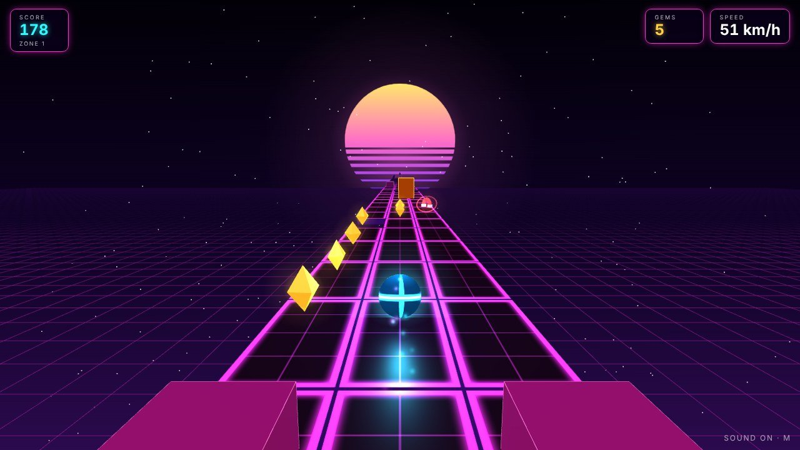
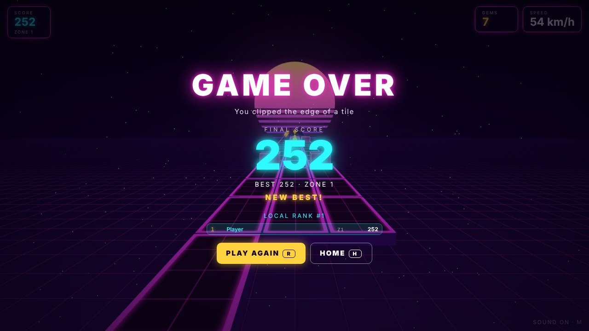

<div align="center">



# ✦ O R B &nbsp; D A S H ✦

### Roll. Jump. Collect. Don't fall into the void.

<a href="https://gorzawebk.github.io/orb-dash/"></a>


<sub>▲ A real run, recorded in the browser: gems, a magnet, a sliding barrier, and finally a missed tile.</sub>

<sub>✦ · · · ✦ · · · ✦ · · · ✦ · · · ✦ · · · ✦ · · · ✦</sub>

</div>

A neon 3D endless runner for the browser. Roll a glowing orb along a floating track in space, collect gems, grab power-ups and dodge blocks, gaps and sliding barriers while the speed keeps climbing.

Everything is in one `index.html`: [Three.js](https://threejs.org/) r128 loads from a CDN, and all graphics and sound effects are generated in code. No build step, no npm. (The pictures in `docs/media` are only for this page.)

<table>
<tr><td align="center" valign="top"><br><sub>Title screen</sub></td><td align="center" valign="top"><br><sub>Into the sunset grid</sub></td><td align="center" valign="top"><br><sub>Game over: score and best</sub></td></tr>
</table>

## 🕹️ How to play

| Action | Keyboard | Touch |
|---|---|---|
| Change lane | <kbd>A</kbd> / <kbd>D</kbd> or <kbd>←</kbd> / <kbd>→</kbd> | Swipe left / right |
| Jump | <kbd>Space</kbd> | Tap |
| Mute | <kbd>M</kbd> | |
| Play again / home (after a run) | <kbd>R</kbd> / <kbd>H</kbd> | Buttons |

- **Gems** are worth 10 points; distance adds to your score too.
- **Blocks**: jump over them. **Gaps**: jump the full-width ones, steer around single-lane ones. **Orange barriers** slide side to side and are too tall to jump.
- **Magnet** (red) pulls nearby gems to you for 8 seconds. **Shield** (green) absorbs one hit for up to 12 seconds.
- Every **1,000 m** you enter a new zone with its own colour scheme.

## 💻 Run it locally

Open `index.html` in a browser (you need an internet connection for the Three.js CDN). Without a Firebase config the leaderboard keeps scores in that browser only.

## 🚀 Publish on GitHub Pages

1. Push this repository to GitHub.
2. In the repository, open **Settings → Pages**.
3. Under **Build and deployment**, choose **Deploy from a branch**, pick `main` and `/ (root)`, and save.
4. After a minute the game is live at [gorzawebk.github.io/orb-dash](https://gorzawebk.github.io/orb-dash/). (For a fork, it's `https://<your-username>.github.io/<repository-name>/`.)

## 🏆 Set up the global leaderboard (Firebase)

The leaderboard uses Cloud Firestore with anonymous sign-in, so players don't need an account. Each player gets one record (username, best score, zone reached, number of runs) that only they can write. The free Spark plan is plenty for a hobby game.

1. Go to the [Firebase console](https://console.firebase.google.com/) and create a project. Google Analytics is optional.
2. **Build → Authentication → Get started → Sign-in method**: enable **Anonymous**.
3. **Build → Firestore Database → Create database**: choose a location and start in **production mode**.
4. In Firestore, open the **Rules** tab, replace the contents with [`firestore.rules`](firestore.rules) from this repository, and click **Publish**.
5. **Project settings** (gear icon) **→ General → Your apps**: add a **Web app** (no Hosting needed). Copy the values from the `firebaseConfig` it shows.
6. In `index.html`, fill in `FIREBASE_CONFIG` near the top of the script:

   ```js
   const FIREBASE_CONFIG = {
     apiKey: 'AIza...',
     authDomain: 'your-project.firebaseapp.com',
     projectId: 'your-project',
     appId: '1:1234567890:web:abc123',
   };
   ```

   These values are meant to be public: they identify your project, and `firestore.rules` controls what anyone can do with it.
7. Commit and push. The home page now shows **GLOBAL LEADERBOARD**.

Optional: under **Authentication → Settings → Authorized domains**, make sure `<your-username>.github.io` is listed. You can also turn on [App Check](https://firebase.google.com/docs/app-check) to make it harder for scripts outside your site to use the project.

### 💡 Good to know

- **Moderation**: delete or edit entries under **Firestore Database → Data → scores**.
- **Identity is per browser**: a player who clears their site data or switches device gets a new record.
- **Usernames aren't unique**: two players can pick the same name.
- **Scores come from the browser**: the rules reject malformed records, scores above 1,000,000 and best scores that go down, but a determined player could still post a fake score. Remove those from the console.

## 🗂️ Code layout

`index.html` is split into commented sections: setup, shared geometries and materials, particles, zones, track generation, player, obstacles and gems, collisions, game state, camera, UI, audio, leaderboard, input and the main loop.

---

<div align="center"><sub>✦ · · · ✦ · · · ✦ &nbsp; keep rolling &nbsp; ✦ · · · ✦ · · · ✦</sub></div>
